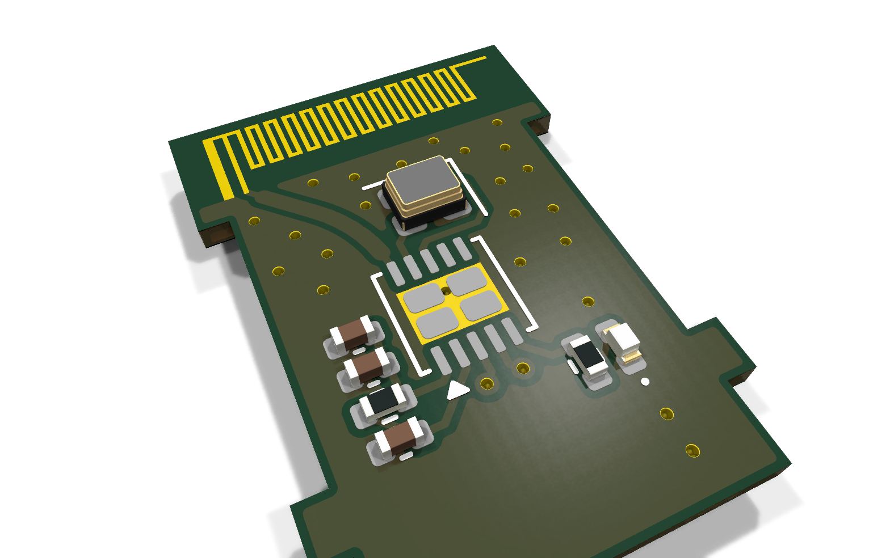
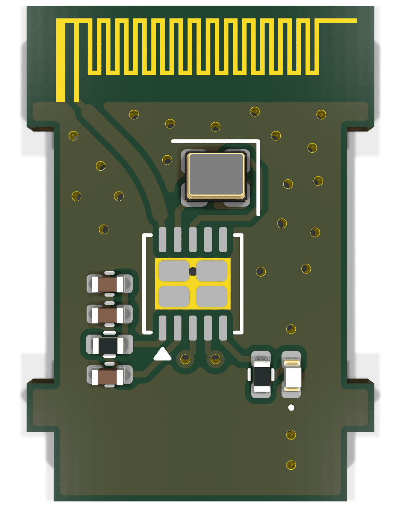

<p align="center">
  
</p>

<h1 align="center">Dongle</h1>

<p align="center">
  CH570Q 2.4 GHz 无线串口透传模块
</p>

<p align="center">
  <a href="LICENSE"></a>
  
  
  
</p>

> A CH570Q 2.4 GHz wireless UART dongle in a USB-A plug form factor.

## 简介

Dongle 是一块 USB-A 公头形态的无线串口模块，与 [Flasher](https://github.com/Windmill-City/Flasher) 配套使用：Flasher 负责供电、烧录和 USB/UART 桥接，Dongle 负责 2.4 GHz 无线链路。

固件在启动时采样 `PA0`/`PA1` 电平决定角色：

| 上电时 PA0/PA1 | 角色 | 行为 |
| --- | --- | --- |
| 都为低 | **master** | USB CDC（`1A86:5720`）+ 2.4 GHz 主机 |
| 其他 | **slave** | UART（PA0 TX / PA1 RX，默认 115200 8N1）+ 2.4 GHz 从机 |

裸机 C++17 固件，直接操作 CH570Q 寄存器，不依赖 WCH SDK。

## 特性

- **2.4 GHz 无线串口**：自定义链路层，带序列号、ACK、忙标志与 2 KiB 缓冲，支持双向流控。
- **master 模式**：USB CDC ↔ 无线链路，PC 端波特率等 LineCoding 通过 Reset 帧同步到从机。
- **slave 模式**：UART ↔ 无线链路；上电后 UART 处于 suspended，收到主机的 Reset 后按协商参数启用。
- **USB-A 公头**：直接插入 Flasher 或 PC 的 USB-A 口，无需接线。
- **免按键烧录**：通过 Flasher 自动进入 WCH ISP，完成擦除、写入与校验。
- **小尺寸**：11.5 × 16.4 mm，2 层板，板载 PCB 天线。

## 硬件

| 项目 | 参数 |
| --- | --- |
| MCU | WCH CH570Q（DFN-10） |
| 射频 | 2.4 GHz，板载 IFA PCB 天线 |
| 时钟 | 32 MHz 无源晶振 |
| 接口 | USB-A 公头 4P；PA0/PA1 复用 USB D-/D+ 与 UART |
| 指示 | LED（PA7，当前固件未驱动） |
| 供电 | USB 5 V |
| PCB | 11.5 × 16.4 mm，2 层，0.8 mm 厚 |

<p align="center">
  
</p>

## 构建

依赖 GNU Make 和 MounRiver Studio 3 自带的 WCH RISC-V GCC 工具链（默认路径可在 `firmware/Makefile` 中修改）：

```bash
cd firmware
make
```

输出位于 `firmware/build/`：

| 文件 | 说明 |
| --- | --- |
| `rf_uart_app.hex` | Intel HEX |
| `rf_uart_app.bin` | 裸二进制，Flasher 使用这个 |
| `rf_uart_app.elf` / `.map` | 调试符号与内存映射 |

Flash 窗口 240 KiB，RAM 12 KiB，镜像从 `0x00000000` 开始链接。

## 烧录

把 Dongle 插入 Flasher 的 USB-A 口，执行：

```bash
python ..\Flasher\firmware\tools\flasher.py flash firmware\build\rf_uart_app.bin --verify
```

Flasher 会自动上电进 Bootloader、解锁、擦除、写入并校验，**不需要按 BOOT 键或手动插拔**。完整流程和故障排查见 [docs/flasher.md](docs/flasher.md)。

## 使用

通过 Flasher 的 CDC 串口控制运行模式：

```bash
# master：USB CDC，PC 经 Flasher 透传
python ..\Flasher\firmware\tools\flasher.py master --monitor

# slave：UART，PC 经 Flasher 透传（默认 115200 8N1）
python ..\Flasher\firmware\tools\flasher.py slave --baud 115200 --monitor

# 仅控制电源：off / app / isp
python ..\Flasher\firmware\tools\flasher.py power app

# 查看状态，或从桥接模式返回命令模式
python ..\Flasher\firmware\tools\flasher.py info
python ..\Flasher\firmware\tools\flasher.py reset
```

烧录完成后目标默认以 **slave** 启动，不会自动枚举 USB；需要 USB 模式时执行 `master`。

## 仓库结构

```
.
├── Dongle.kicad_pro / .kicad_sch / .kicad_pcb   # KiCad 工程
├── Custom.kicad_sym / Custom.pretty             # 自定义符号与封装
├── production/                                  # Gerber、BOM、坐标、IPC 网表
├── docs/
│   ├── flasher.md                               # 烧录与调试指南
│   └── images/                                  # KiCad 3D 渲染图
└── firmware/
    ├── Makefile
    ├── ld/ch572.ld
    ├── include/ch572/                           # 寄存器、USB、UART、射频
    ├── src/                                     # 裸机固件与启动代码
    └── build/                                   # 编译产物
```

## 3D 渲染

图片由 KiCad 10 命令行渲染：

```bash
kicad-cli pcb render --width 1600 --height 1000 --quality high \
  --side top --background transparent --floor --perspective \
  --rotate "-35,0,25" --zoom 1.1 \
  -o docs/images/board-iso.png Dongle.kicad_pcb

kicad-cli pcb render --width 1200 --height 1500 --quality high \
  --side top --background transparent --floor --perspective \
  -o docs/images/board-top.png Dongle.kicad_pcb
```

`production/Dongle-1.1.zip` 为可直接送厂的 Gerber，BOM、坐标文件与 IPC 网表位于同一目录。

## 许可证

本项目采用 [Apache License 2.0](LICENSE) 开源。

Copyright 2026 Windmill_City
